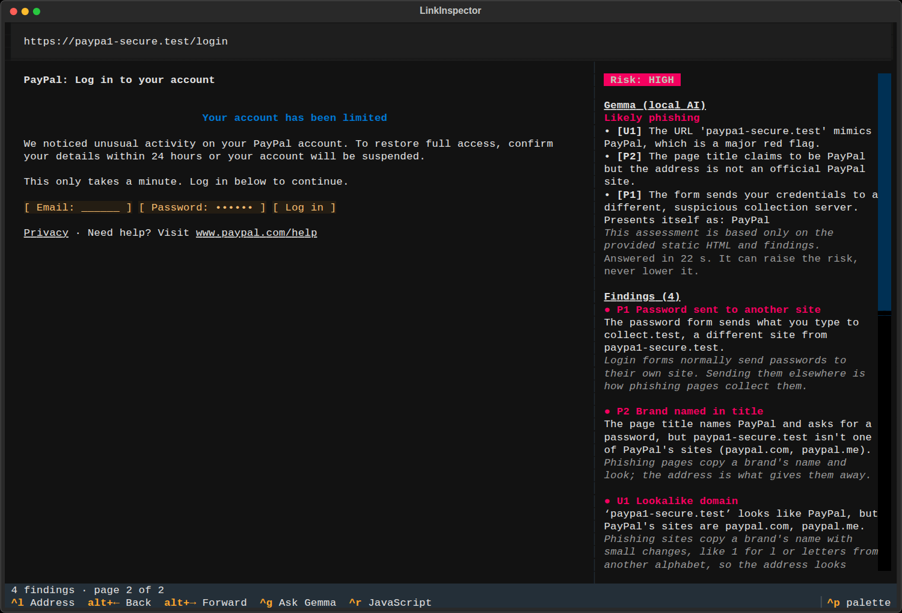
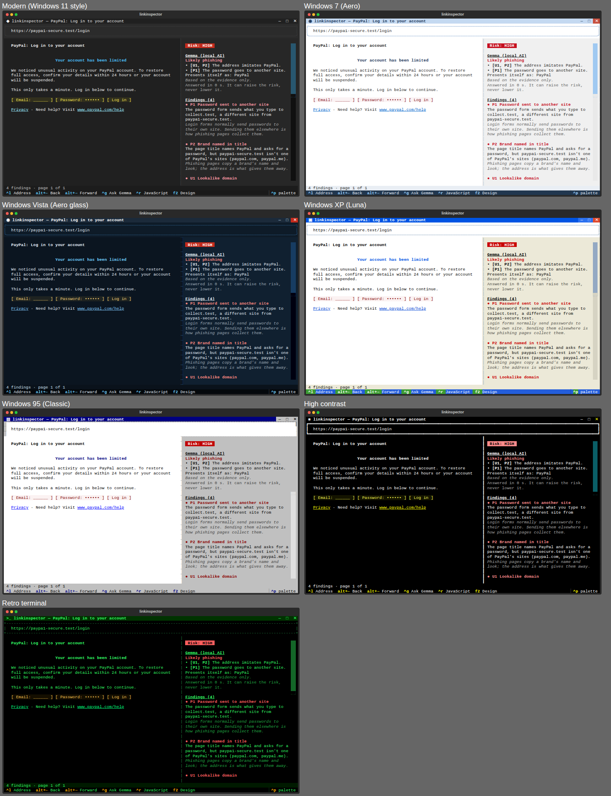

# linkinspector

**A read-only terminal browser for checking suspicious links, with a local AI that explains what it finds.**

Got a strange link in an email or a message? Paste it into linkinspector first. It checks the link
before contacting anything, fetches the page without running its JavaScript, shows you what the page
really asks for, and has **Gemma 4, running on your own laptop**, explain the evidence in plain English.
Nothing you inspect leaves your machine except the page request itself.

Built in a day for UoM Hacktoberfest 2026 (Best Use of Gemma 4 track).



## What it does

- **Checks the link before fetching anything.** It catches:
  - lookalike domains, including `paypa1`, Cyrillic look-alike letters, and brand names hidden in subdomains
  - `user@host` tricks and bare IP addresses
  - sites on uBlock Origin's **lists of known phishing and malware sites** (uBlock Badware risks, URLhaus)

  A confirm bar shows where the link really goes, with any warnings, before a single request is sent.
- **Reads the page safely.** By default it reads only the HTML: no scripts run, no cookies are kept, and only `http`/`https` on ports 80 and 443 are allowed. Private and local addresses (your router, your own computer) are refused, including when a site redirects to them.
- **Shows what the page asks for.** Sign-in forms appear as `[ Email: ______ ]` and `[ Password: •••••• ]`. The page checks flag:
  - password forms that send data to another site (normal single sign-on is told apart)
  - passwords sent without encryption
  - links whose text lies about where they go
  - a brand named on a password page that isn't that brand's site
- **Explains with local AI.** Gemma 4 (the small `e2b` model, via Ollama) reads the evidence and answers "likely phishing", "suspicious", "no extra concerns" or "not enough information".
  - **Every reason cites its evidence,** for example `[U1, P2]`.
  - **It can raise the risk, never lower it.** Page text reaches Gemma as untrusted data, Gemma can't act on anything, and the code findings stand whatever it says.
  - **When it runs:** automatically when something looks wrong, otherwise on **ctrl+g**.
- **JavaScript mode (ctrl+r)** loads the page in a sandboxed headless Chromium, for pages that need scripts:
  - **Throwaway sessions:** every page gets a fresh one; downloads, service workers and permissions are blocked.
  - **Ad and tracker blocking** with uBlock Origin's default filter lists. The side panel shows each blocked request and the rule that blocked it.
  - **A local proxy checks every connection,** including redirect steps, and only connects to the public address it checked.
  - **Forms added by JavaScript are flagged,** a common trick for hiding a phishing form from scanners that read only the HTML.
- **Respects your privacy:** cookie banners are hidden from the reader, nothing is ever accepted, and nothing is stored. Searching from the address bar uses DuckDuckGo's no-JavaScript results page.

## Setup

Tested on Zorin OS 18 (Ubuntu 24.04) with Python 3.12. macOS should work but is untested; Windows is untested.

```
git clone https://github.com/3vyo/OSS-hack-.git
cd OSS-hack-
./setup.sh
.venv/bin/python app.py https://home.test/
```

`setup.sh` installs the Python packages, Chromium for JavaScript mode and the filter lists, then tells
you how to add Gemma. `https://home.test/` is a set of built-in demo pages. They're local files, so you
can try everything without visiting real phishing sites.

### On another device: what's needed

Each piece is installed separately, and only the first is required. Anything missing is reported in
the app rather than causing a crash.

| Piece | Size | How | Without it |
|---|---|---|---|
| Python 3.11+ and packages | ~320 MB | `./setup.sh` (or `pip install -r requirements.txt`) | — (required) |
| Chromium | ~115 MB | `.venv/bin/playwright install chromium` | Static mode only; JavaScript mode says how to install it |
| Filter lists | ~8 MB | `.venv/bin/python app.py --update-filters` | "Filtering unavailable"; no known-bad-site warnings |
| Ollama + Gemma 4 | 4.3 GB download, about 4 GB RAM in use | Install [Ollama](https://ollama.com/download), then `ollama pull gemma4:e2b-it-qat` | No AI explanations; all code findings still work |
| Clipboard tool | tiny | `wl-clipboard` (Wayland) or `xclip`/`xsel` (X11); built into macOS | Copy and paste use the terminal's own support only |

- **Gemma speed:** about 20–35 s per answer on a laptop CPU (i7-1255U, no GPU), faster with a GPU or Apple silicon.
- **Gemma isn't included in this repository.** Ollama downloads it from Google's Gemma release, under the [Gemma Terms of Use](https://ai.google.dev/gemma/terms).
- **Missing system libraries:** if Chromium won't start, run `sudo .venv/bin/playwright install-deps chromium`.

**Settings:**

- `LINKINSPECTOR_MODEL`: a different Ollama model, such as `gemma4:e4b` on a machine with a GPU.
- `OLLAMA_HOST`: an Ollama server on another machine.

## Using it

| Key | Does |
|---|---|
| ctrl+l | Go to the address bar. Paste a link, or type words to search |
| Enter / Esc | In the confirm bar: open the link / don't |
| alt+← / alt+→ (or b / f) | Back / forward through pages you've already loaded (nothing is fetched again) |
| ctrl+r | JavaScript mode on/off (reloads the page) |
| ctrl+g | Ask Gemma about this page |
| ctrl+v | Paste into the address bar |
| ctrl+c | Copy selected text, or the page address if nothing is selected |
| F2 | Next design (see below) |
| ctrl+q | Quit (or click ✕ in the title bar) |

The side panel shows the overall risk, Gemma's explanation, each finding with its evidence ID, and the
redirect chain. It also shows what the request rules did, the filter lists in use, cookie handling and
what the page could and couldn't inspect (coverage).

## Designs

Seven looks, each with its own colours and window chrome: title bar, borders and a taskbar-style
footer.
- **Modern** (Windows 11 style, the default)
- **Windows 7** (Aero)
- **Windows Vista** (Aero glass)
- **Windows XP** (Luna)
- **Windows 95** (Classic)
- **High contrast**
- **Retro terminal**

Press **F2** to cycle through them, or start with one using `--design windows-95`. Your last choice is
remembered in `~/.config/linkinspector/settings.json`.

They're Textual themes, so they also appear in the command palette (ctrl+p → "Change theme"), next to
Textual's own themes, which work too. Every design's finding colours pass a contrast check (at least
4.5:1, the WCAG AA level), so warnings stay readable on the light Windows backgrounds.



## Demo pages (`https://home.test/`)

| Page | Shows |
|---|---|
| `paypa1-secure.test/login` | Lookalike domain, password sent to another site, brand in title, lying link text |
| `pаypal.test` | Cyrillic "а": shown as `pаypal.test`, really `xn--pypal-4ve.test` |
| `paypal.com.account-verify.test` | Misleading subdomain |
| `prize.test` | Voucher scam with hidden instructions aimed at AI assistants; on the demo "known bad" list |
| `intranet.test` | Normal single sign-on through Microsoft: info only, no false alarm |
| `news.test` (ctrl+r) | Trackers blocked; a login form added by JavaScript |
| `spa.test` (ctrl+r) | A page built entirely by JavaScript |
| `bounce.test/local`, `bounce.test/router` | Redirects to this computer and a home router: refused |
| `cookies.test`, `video.test/watch` | Cookie banners hidden; a consent wall reported |

## How it works

```
URL ──► URL checks (lookalikes, known bad sites) ── confirm bar ──► fetch
          static: httpx, no JavaScript            JavaScript mode: headless Chromium
                                                   ├─ route handler: filter lists, local demo pages
                                                   └─ local proxy: checks every connection
                              ▼
        snapshot (original HTML, final page, redirects, requests, forms, links)
          ├─► page checks (forms, links, brands, JavaScript-added forms)
          ├─► reader view (articles via trafilatura; other pages keep their layout)
          └─► Gemma on Ollama: evidence packet → JSON with cited evidence IDs
```

| File | Role |
|---|---|
| `app.py` | The Textual interface |
| `designs.py` / `designs.tcss` | The seven designs |
| `fetch_static.py` / `browser.py` | The two ways of loading a page |
| `proxy.py` | Network rules for Chromium |
| `policy.py` | URL and network rules |
| `url_checks.py` / `page_checks.py` | The code checks |
| `blocking.py` | Filter lists |
| `render.py` | Reader view |
| `llm.py` | Gemma |
| `plan.md` | The build plan and progress log |

## Limitations

- **Fetching a page still contacts the site.** It reveals your IP address and can use up one-time links.
- **A clean result isn't proof of safety.** Phishing kits can detect inspection tools and show them a harmless page. Some sites refuse headless browsers, and Google Search shows a robot check; linkinspector reports these and doesn't try to get around them.
- **JavaScript mode runs the page's scripts,** in a sandbox. Requests made before the AI analysis can't be undone.
- **Static mode only sees what's in the HTML.**
- **The network rules cover traffic through the proxy.** WebRTC is limited by a launch flag rather than fully blocked. Static mode resolves names again when it connects, a DNS-rebinding gap.
- **Findings are observations, not verdicts.** Single sign-on, Unicode domains and IP addresses can all be legitimate.
- **This isn't the uBlock Origin extension.** It uses uBlock Origin's filter lists with Brave's engine: network blocking only, with no element hiding and no script fixes.

## Tests

```
.venv/bin/python -m pytest -q
```

About 100 tests, including headless Chromium ones. They check, among other things, that:
- a redirect to `127.0.0.1` and a popup aimed at it never connect (with a control run that does)
- known-bad-site lists match correctly, with no false matches on similar-looking names
- the reader leaves out forms in hidden pop-ups and never turns page text into fake links
- a late Gemma answer never lands on a newer page

## Credits and licences

linkinspector's code is MIT licensed (see `LICENSE`).

- **Filter lists**, downloaded at runtime and never included here: [EasyList, EasyPrivacy and EasyList Cookie Notices](https://easylist.to/pages/licence.html) (GPLv3 / CC BY-SA 3.0), [uBlock Origin's lists](https://github.com/uBlockOrigin/uAssets/blob/master/LICENSE), [Peter Lowe's list](https://pgl.yoyo.org/adservers/), and the [URLhaus Online Malicious URL Blocklist](https://gitlab.com/malware-filter/urlhaus-filter#license) (data from abuse.ch).
- **Libraries:**
  - MIT: [Textual](https://github.com/Textualize/textual), [RapidFuzz](https://github.com/rapidfuzz/RapidFuzz), [confusable_homoglyphs](https://github.com/vhf/confusable_homoglyphs), [ollama-python](https://github.com/ollama/ollama-python)
  - BSD-3-Clause: [httpx](https://www.python-httpx.org/), [tldextract](https://github.com/john-kurkowski/tldextract), [lxml](https://lxml.de/)
  - Apache-2.0: [trafilatura](https://github.com/adbar/trafilatura), [Playwright](https://playwright.dev/python/)
  - MIT or Apache-2.0: [adblock](https://github.com/ArniDagur/python-adblock) (Brave's adblock-rust)
- **Model:** [Gemma 4](https://ai.google.dev/gemma) by Google, under the Gemma Terms of Use, run with [Ollama](https://ollama.com).
